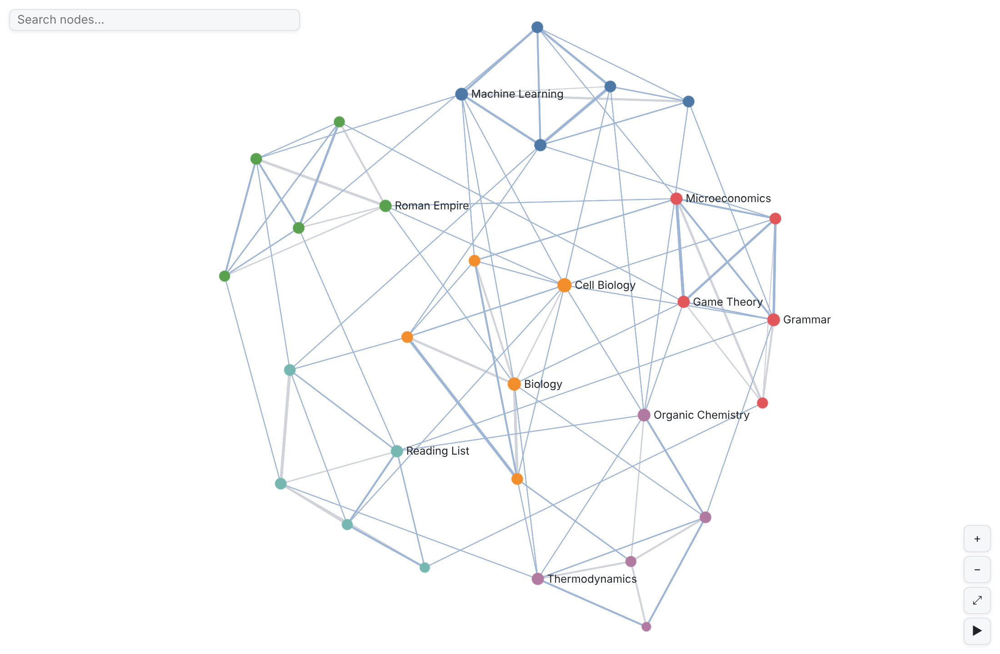
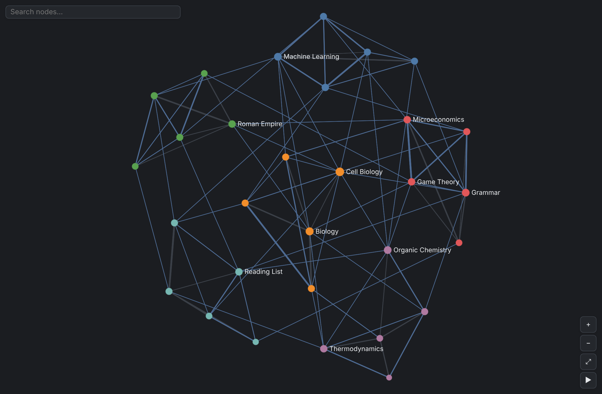

# Graph View for RemNote

See your knowledge base as an interactive graph. Find clusters of related notes, spot orphaned documents, and jump to any Rem with one click.



## Features

- **Whole-knowledge-base graph.** Run **Open Graph** from the Omnibar (Ctrl/Cmd + K).
- **Local graph in the right sidebar.** It follows the Rem you are working in and shows what it connects to, 1 to 3 hops deep.
- **Documents or all Rems.** By default each node is a document, and links from its bullets roll up into it. That keeps large knowledge bases readable. Switch to *All Rems* for the full detail.
- **Hierarchy and references.** Show parent/child links, `[[references]]`, or both. References are drawn in blue.
- **Clusters.** Communities of closely linked notes get their own colour.
- **Search.** Type to find a node, press Enter to fly to it, or click ↗ to open it.
- **Click to open.** Clicking a node opens the Rem in RemNote. Hovering highlights its neighbours.
- **Filters.** Hide orphans or daily documents. RemNote internals (powerups) are never shown.
- **Fast.** WebGL rendering handles tens of thousands of nodes, and the layout runs without freezing the editor.
- **Dark mode** support.



## How to use

| What | How |
| --- | --- |
| Open the full graph | Omnibar → **Open Graph** |
| Graph around the current Rem | Omnibar → **Open Local Graph** |
| Local graph next to your notes | Right sidebar → **Local graph** tab |
| Open a Rem | Click its node |
| Move around | Drag to pan, scroll to zoom, ⤢ to fit everything |
| Re-arrange | ▶ continues the layout, ❚❚ stops it |
| Pick up new notes | **Refresh** reloads your knowledge base |

Your filter choices are remembered.

## Privacy

The plugin only **reads** your Rems (read-only permission). Everything is computed locally in your browser. Nothing is sent anywhere.

## Feedback

Found a bug or have an idea? [Open an issue](https://github.com/Justtolook/RemNote-Graph-Plugin/issues).

---

## Development

```bash
npm install
npm run dev          # serves the plugin on http://localhost:8080
```

In RemNote, open *Settings → Plugins → Build → Develop from localhost* and enter `http://localhost:8080`.

```bash
npm test             # unit tests (graph building)
npm run check-types  # TypeScript
npm run demo         # standalone demo with sample data: open dev/demo.html
npm run build        # validates the manifest and creates PluginZip.zip
```

Code layout:

- `src/lib/buildGraph.ts`: turns Rems into nodes and edges (pure, unit-tested)
- `src/lib/richText.ts`: plain text and reference extraction from RemNote rich text
- `src/lib/graphModel.ts`: graphology graph, cluster colours, ForceAtlas2 layout runner
- `src/lib/remnote.ts`: everything that talks to the RemNote SDK
- `src/components/`: React UI (panel, Sigma.js view)
- `src/widgets/`: plugin entry points (index, popup, sidebar)

The screenshots use the sample data from `dev/demo.tsx`.

## License

MIT
